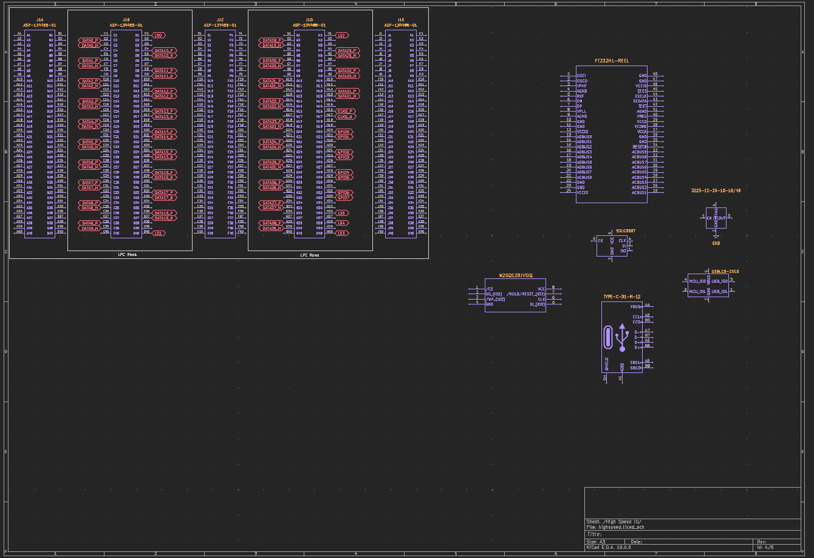
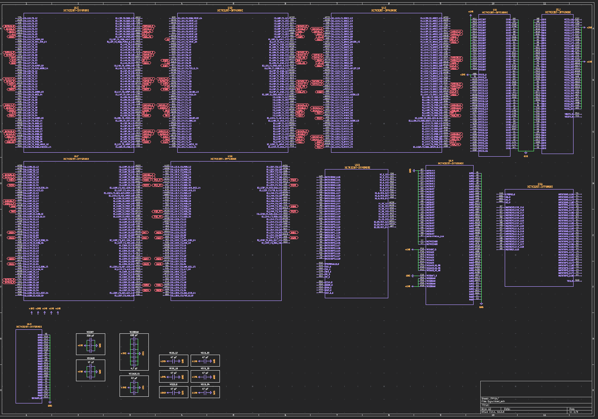
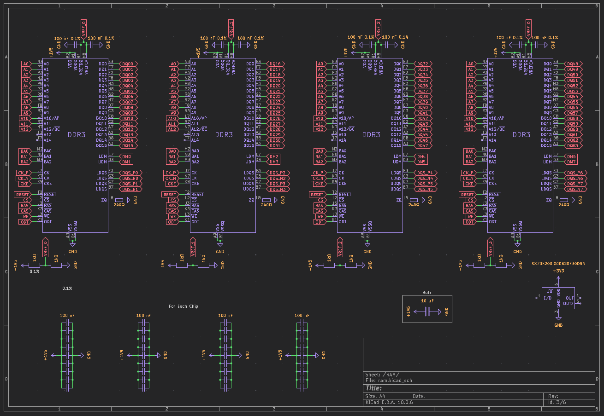
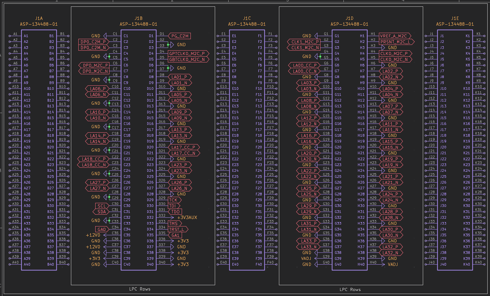
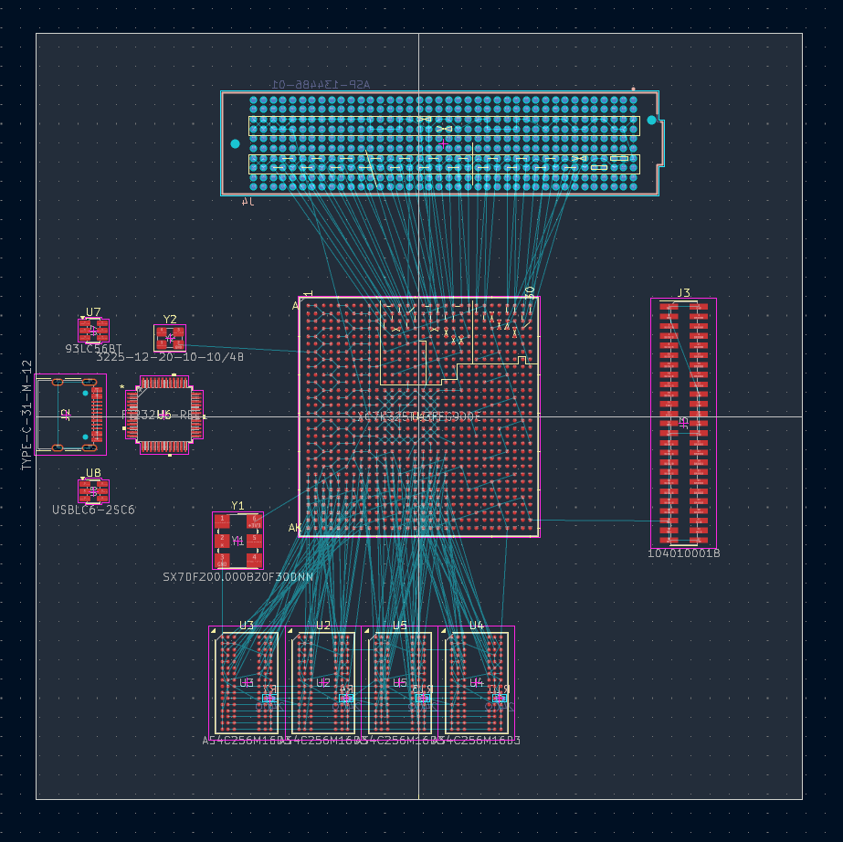
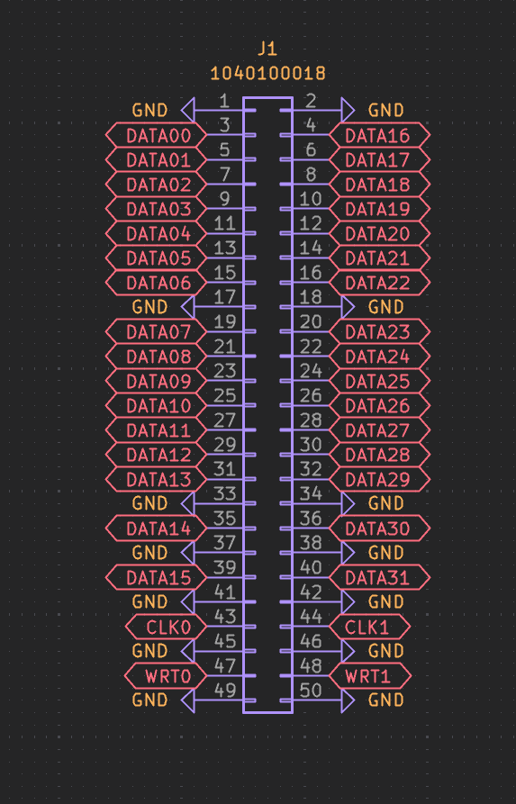
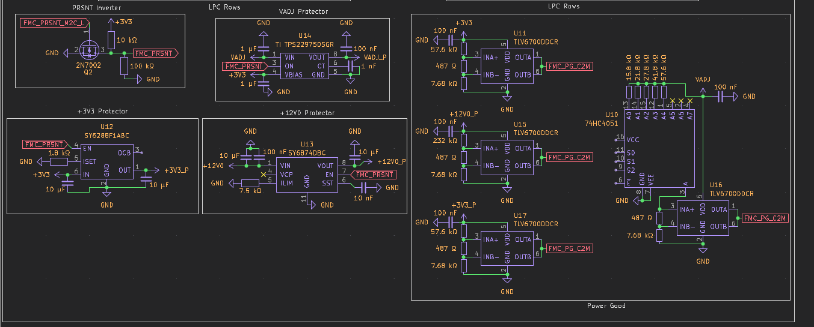
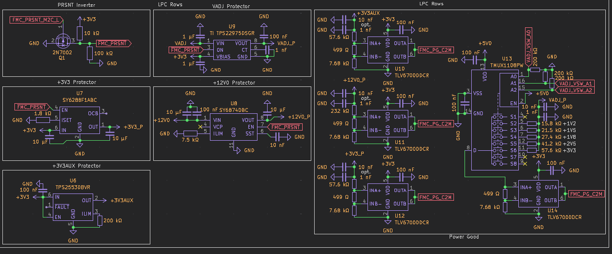
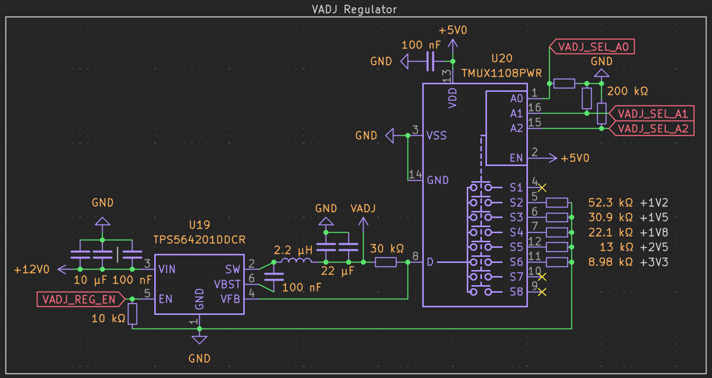

# October 4, 2026: FPGAs are Actually Pretty Hype
<!-- fabricate:entry 138 -->

Okay, the most important part of an FPGA board is the FPGA, so what is it, exactly? An FPGA stands for "Field-Programmable Gate Array," and if you are like me, that provides no usable information. FPGAs are a type of Programmable Logic Device (PLD). Other PLDs, like CPLDs, typically have a coarser, simpler architecture than an FPGA. FPGAs use Hardware Description Languages (HDLs) to control how their many programmable logic blocks work with other blocks to perform functions. The Field Programmable part of an FPGA comes from how its wiring can change based on instructions from something written in an HDL, as opposed to an Application-Specific Integrated Circuit (ASIC) that cannot change its logic wiring. FPGAs are often used to prototype before going all in on production of an ASIC. In my case, I am using an FPGA because I want to be able to change it to whatever I want and don't want to order a huge load of ASICs. An FPGA is NOT a microcontroller, but you can describe its hardware (lol) to make it work like a microcontroller, or even a processor.

**What makes an FPGA board a Tier 2 project, offering $250 in grant funding?**\
While putting this in the same tier as a robot arm, handheld console, or battle bot might seem strange, as the others have far more physical possibilities and polish (maybe), an FPGA board is very complex and requires precise PCB design. FPGAs often require several different voltages, and they have so many pins that a 4- or 6-layer PCB is necessary, as well as DDR RAM if you want storage that is slightly longer than the BRAM. Obviously, there is more, but I don't know enough.

**What FPGA will I use on my board?**\
Uhhhhh idk yet, but I have a good idea. I want to be able to do some cool stuff with electricity and lots of data, so I want something on the higher end of the speed scale. I think I would get a Xilinx Kintex-7 XC7K70T-2FBG676C or XC7K160T-2FFG676C. The former is about $35, and the latter is more like $80. If I can find a way to level up this board to Tier 1, I may go even further because I think that sounds cool.

**Other stuff that would probably go on the board**\
RAM, I haven't researched enough about RAM yet. Capacitors, lots of them. JTAG adapter. Ports going out to connect with other devices. Headers, if I want to connect another module directly if I fear the cables. Lots of power stuff and regulators. Clock generators. Buttons and LEDs.

I intend to supply power to this board with a bench power supply (OOH, I could make that!), so it doesn't require an extreme amount of power thingamabobs, just enough to handle the power degradation from traveling over a cable.

___

## Brainthinks from the same day

I don't think headers would be the best to preserve signal integrity. Upon doing more research, it sounds like edge connectors or mezzanine connectors will be the best. Both for signals and power. Edge connectors put the card at a 90-degree angle, while mezzanine connectors put it parallel. I think a mezzanine connector would be better, even for power. The large number of pins on a mezzanine connector helps reduce power quality degradation by lowering parasitic inductance, canceling out the magnetic field (if PWR and GND are alternated), and having a large cumulative surface area. Surface area is important because, while power will be sent as DC, the FPGA will pull power in very fast, erratic pulses, creating AC noise. I will have a mezzanine connector for both power and a peripheral board for testing.

___

**Total time spent: 2h 30m**

# October 5, 2026: That's, ummmm, a lot of pins
<!-- fabricate:entry 152 -->

I mean I did say that PCB design is comforting, but that was with a simple board that connects some preassembled boards. Now I have to learn what all these pins mean.

Okay, I did some more research and have decided that this project likely belongs in Tier 1. An FPGA board is provided as a Tier 2 example for simpler FPGAs, but I am using a far more complex FPGA, as well as DDR RAM. A similar FPGA board from Blueprint that also had RAM was rated as Tier 1. I also did some more research on the processor and found a better and cheaper model! The XC7K160T-3FFG676E is faster (Speed grade 3 instead of 2) and has a higher maximum operating temperature (E has a max of 100 degrees while C maxes out at 85), and LCSC sells it for $73.50, as opposed to $96 for the other. I don't really need the 676 ball package, but the 484 version doesn't have an equivalent sold by LCSC.

NEVERMIND! LCSC sells an XC7K325T-3FFG900E for nearly the same price! I do not need this, but why not pay the same price for something FAR better! Now I have to redesign my schematic (At least where I got to) and get less sleep (I need more sleep; it's Klausur season)

Okay, there are a lot of power lines. I don't understand it all, but there are several voltages the chip takes. VCCO pins can take many voltages, depending on the interface. There is also a lot of stuff for the GTX transceivers, which I also don't fully get. I haven't gotten to labelling all the IO pins yet, (which is more than the 646-ball). I did route the GND, though!

___

**Total time spent: 3h 20m**

# October 6, 2026: RAMpocalypse
<!-- fabricate:entry 167 -->

Found some RAM I am fine with using. 4 chips of 16 bit DDR3L 933 MHz. Each chip is $11, which I find quite insane. $11 is also the lowest price I found during my searching. The chip is the Winbon W632GU6NB-11, sourced from LCSC, obviously. I think I will use Aisler as they are based in Europe, have a minimum assembly count of 1 (I believe), and can source their parts from LCSC. I will probably see if they can pre-order the FPGA and hold it for me as I design it, as there is only 90 left. I will also have to ask on slack. Parts and manufacture will probably be more expensive, but it will be cheaper than assembling 2 boards from JLCPCB.

I added the RAM to the schematic, routed grounds, and am currently waiting for Vivado to download so that I can use MIG to handle the DDR3 controller. I am doing this now because it also tells what pins I should I use out of the 900 I have to choose from :3

I learned that 16 bit DDR3 chips separate half the bits into "upper" and half into "lower" bits. This is because the 16 bit chip is structured as two 8 bit slices. The signals alternate between the two slices, controlled by upper and lower data strobe differential pairs.

Finished schematicizing (???) the 325T and the 4 RAM chips. I initially tried to make it look nice, but the sheer volume of connections decided that would not happen. Yes I did actually spend 6 hours doing this; of course, not in one sitting. Maybe like 2 or 3. I used MIG to generate the memory interface stuffs, which does include the wiring, which is how I put everything together (and why the connections could seem random). I am dead tired now and there will be tea to wake up to from my rocketry club back home. goodnite!

Upon Looking at the schematic again, I realized that people don't design schematics like this. I will probably make it look passable tomorrow

**Total time spent: 6h**

___

# October 7, 2026: Restart!

I will be making the schematic readable today, but right now, I found a cheaper RAM option. The Winbon W63**1**GU6NB-11 is less than half the price of the 632, but also has half the storage. I have also set out other components I want to include on my board: HDMI port, MicroSD card slot, some LEDs, and some DIP switches.

I was able to successfully make the schematic look nicer! I haven't done the FPGA side, but it is getting late. I was also able to do more pins, such as the VREF pins, which need to be half the voltage of the main RAM supply voltage. The footprint of the new RAM is the same, the only difference being that it has 1 less address pin. There were more differences for MIG. I also switched to dark mode, which is the most important thing done this session.

**Total time spent: 3h 20m**

___

# October 8, 2026: New day, new RAM

Realized my RAM was out of stock. found a cheap RAM chip and redesigned the schematic. This one looks even better! It also has decoupling capacitors. I also got a scare when searching for a crystal oscillator, thinking I would have to get a custom one, but realized MIG was being MIG and I could change the RAM speed to get a more favorable frequency.

RAM schematic is all done. FPGA memory interface is almost done, I just need to do some power thingies like decoupling. I also began setting up my mezzanine connector. The really nice thing about it is that there is a standard called FMC (FPGA Mezzanine Connector, wow!). I will be using the FPGA's GTX transceivers, so I have to use the HPC (High Pin Count) variant. Because I want to be extra, I felt the need to use 8 GTX lanes (Out of my 12) for this FMC, meaning I need two of them.

You might be able to see the new problem here. I'll figure something out (add a third?). The specific FMC I am using is the ASP-134488-01. 

Another annoying thing with the GTX system is that it requires very precise power supplies.

**Total time spent: 5h 50m**

___

# October 9, 2026: New day, reday

Get it? It's like a play on words of "redo". Anyways, I'm not using 2 HPC connectors, just 1. Good thing I never started anything intense. I did attached the signal names to all the pins on the FMC to later attach to the FPGA. To find out which pins I'm supposed to attach to what signals, I did some research and found the KC705 Evaluation Board, which documents its full pin assignments. It has an HPC and LPC connector, but many of their pins are left unconnected, so I can't copy it line for line, I will probably group pins by differential pair, routing them to the closest banks available. Higher priority data lines will be assigned to banks closer to the connector's side of the FPGA, which will be on the opposite side from the RAM.

I also thought longer and harder about what I want this project to be. I started this board to test out a few ideas I had in mind, but these ideas don't utilize all the capabilities of the FPGA. I think I will keep this board to its original design intention, but I might make another, new FPGA board that is more intended to be a full dev board. I feel really close to getting out of the schematic phase, I just need to figure out the pins for the HPC connector, add some smaller components, work out the power, then boom! Power won't be too hard since it is just the schematic. PCB will be far more annoying. For the PCB, I am thinking of doing an 8 layer board with 3 ground planes and a power plane that is split into various regions to cover the varying voltages of the board. Layer 6 would have a ground plane on both sides of it, so it would be the high speed or sensitive signal layer. layer 1 and layer 8 are on the surface, but they are also on the surface. They are adjacent to a ground plane, though. Layer 3 is adjacent to a ground and the power plane. The ground plane is closer, but it isn't as good as the others. Or maybe it is fine, I don't know. 

Actually, as I am writing this, I think I might just do a LPC connector. Like I said earlier, this board is being designed for a few specific purposes in mind, and those purposes don't need a whole HPC connector.

**Total time spent: 4h 30m**

___

# October 10, 2026: Planned the FMC connections

I am sticking with the HPC connector because it is cheaper than the LPC connector. I also realized that I don't have to follow the standards set in place because I am no longer designing this board to be all encompasing. For the mezzanine card side, the LPC connectors are cheaper, so I will only use the pins on the HPC that an LPC uses.

I began planning the routing of all the pins. I first looked at a map of the chip to determine which banks I should prioritize, then I started mapping out where all of the pin pairs are at in those banks. Quickly into that, though, I realized the futility of it all and that I am going to have to length match no matter what, so I just assigned signals based on the order of the pins in the schematic. I also added more components to my schematic, including the JTAG Converter, flash storage, USB-C connector, 200 MHz crystal oscillator for the DDR3 RAM, a 12 MHz crystal for the JTAG Converter, an EEPROM for the vivado config, and a USB ESD protector. I have not routed them yet, though.

I am now going back to the standardized method because  I don't know what the future will bring, and I want to be able to do cool stuff. Guhhh. I am not an efficient worker. And I also often have a cat on my lap, so that further reduces efficiency. For tommorow, though!

**Total time spent: 6h 10m**

___

# October 11, 2026: Redo, again

I thought I would change my journal style up a bit to make it more involved, so I will actively be journaling as I work. I will also include what I want to accomplish today

- Bring the FMC up to ANSI/VITA 57 standards
- Connect the whole JTAG converter system
- Begin work on power distribution

I began assigning the correct pin labels, but then got side tracked with the VADJ pins. I think I will use a simple linear regulator with the control voltage coming from a PWM module in the FPGA passed through an RC filter.

I also got side tracked with LVDS and skew. After all my research, I have realized I don't need anything else, I can just use my 200 MHz clock from the memory interface for deskew

I just realized when I set out these goals, I forgot about the whole JTAG Converter, which has a decent amount of pins that needs care for connecting. I might postpone the power supply to tomorrow.

Well I had a lot less time than I expected today. I attached global labels to all the pins on the FMC side. That is really all. Most of my time was spent researching the more theory how of how to work all of these pins. One such thing I learned about was why there are JTAG pins on the connector. It is there so that the peripheral board can know what is up with the fpga board and work properly. I also realized I need another usb connector, as I need a way to output the processed data from the fpga.

**Total time spent: 2h 10m**

___

# October 16, 2026: New connector

I thought I would just take a single day break, but that ballooned into a 5 day break. Now I am back and ready. During my break, I did some thinking and realized that I wanted the FPGA to be able to connect to a THIRD device, and have settled on a 2x25 IDC box header connector. This one does not have a standard, so it is much more loosey goosey. Today, I hope to:

- assign what pins do what for the new connector
- finish connecting the FMC

And my stretch goals:

- Add that other connector that has yet to be decided what it will be. Very simple one.

I assigned the pins for the new connector, which did not take long at all. The FMC is being annoying again. I have been messing around with the parts on the pcb, and I was trying to assign pins based on proximity to minimize annoying length matching. The annoying thing is that the FPGA doesn't exactly advertise what pins are differential pairs, so I have to manually look them up every time. I may also want to have the FPGA swap the signals at the pins because connecting P to P and N to N makes some lines crossing.

I just learned that the grave button highlights all pins in the same net; I think this is the happiest I have ever been

The cat is 100% at fault for this, but I did not finish connecting the FMC to the FPGA. I got rows G and H, as they were the ones closest to banks 16, 17, and 18. I want to use banks 16, 17, and 18 because they are on the opposite side of banks 32, 33, and 34, which are the RAM banks. The new connector will probably connect to banks 14 and 15. Banks 14 and 15 do have special purposes, though. Bank 15's IO pins connect to the internal ADC, but I have no plans on using it, so I don't need to worry about it. Bank 14 is for working with external flash during boot. I don't need to worry about fast boot times, so the majority of the pins are normal. For the second, basic connector, it can really go anywhere. I might use Bank 13.

**Total time spent: 5h 30m**

___

# October 17, 2026: Finishing this damn connector (WRONG)

Today I want to

- Finish connecting the FMC
- Find new connector and assign nets to it
- Begin work on the JTAG converter stuffs

I just learned about clock regions on the FPGA. I was wondering what the difference between SRCC and MRCC was, as they are both clock capable. MRCC is Multi-region clock capable while SRCC is single-region clock capable. Well, what are the regions? The chip is split in half into two columns and each column is divided into 5 rows so that each region is 50 pins high. Wait, 50 pins high? I thought the FPGA chip was only 30x30! While the BGA is 30x30, the silicon is not. 50 pins high is the height on the silicon. Luckily, every I/O bank has 50 pins, so, for those banks, one clock region corresponds to one bank. I checked what pin type MIG assigned the DDR clock to and was surprised to see it was an SRCC pin. The memory interface spans across all 3 HP banks, each with their own clock region. However, for reasons that I don't really understand what they mean, but will still tell you, its all good. It is okay because it doesn't use Multi-Region Routing Buffers, it routes directly to a Clock Management Tile (CMT), and that CMT makes a reference clock thing and does something with phasers. It only works when the signal is being distributed to other regions in the same column, which it is.

I just spent way to long trying to prepend FMC_ to all of the FMC connector labels. I got it to work, but I just realized I never renamed the labels on the FPGA side.

I FINISHED CONNECTING THE IO PINS! Now I just need to figure out dedicated clock lines, VREF, PRSNT, GTX stuffs, JTAG pins, and other miscellaneous stuff. I would also like to revise a previous statement I made, saying that following the FMC standards would allow any expansion card to plug into my FPGA board. Following the standards gives me the highest chance of having an expansion card work. The standards only standardize the pin assignments of the FMC, not how the pins connect to the FPGA.

I have finished connecting the power protection for the FMC. It was a very interesting process. So, except for +3V3AUX, the power lines can only go live when the PRSNT pin is low. It is tied to ground on the mezzanine side, and it is tied to +3V3 on carrier side. For the +3V3 and VADJ lines on the FMC, which I named +3V3_P and VADJ_P, I used a switch with active low control to stop the power if the enable pin reads high. For +12V0, I opted for a P-channel and N-channel MOSFET because it is cheaper than using a dedicated switch capable of the voltage with active low control. The N-channel inverts the PRSNT signal for the P-channel MOSFET. All of these 3 protected lines also need to be stable to trigger the Power Good signal, which accomplished with a 3-input positive-AND gate.  
I also connected the GTX pins. For this, I used the KC705 evaluation board for reference. It has an LPC FMC, and its GTX transmit/receive pins connect to GTX bank 117 and its REFCLK goes to 116. Because I don't have many connectors as the KC705, I connected the transmit/receive pins and the REFCLK to bank 118. I chose it because it will be the closest to the FMC. Now all I have left is the dedicated clock pins and the VADJ source.

Nevermind, I redid the power protection. I realized the switch I chose for VADJ wouldn't work for the complete range of VADJ. The only one I could find which had protection and the complete range was active high enabled, so I repurposed the inverter for +12V0 to serve as just the general inverter. While I was at it, I looked for a +12V0 switch and replaced the MOSFET.

Okay, wow, it just keeps getting more complicated. I replaced the 3V3 switch with an active high enabled one because it was cheaper. My power good system was just wrong. Power needs to be properly settled, not just on. I found some window comparators. However, the window is based on resistors, which is fine, and the docs give their calculation formulas, but VADJ varies and requires different resistors for different voltages. Luckily, VADJ can only be some specific voltages in the 1V2 to 3V3 range, so I found a switch to toggle between the first resistor. After the first resistor, it is all the same, no matter what voltage you use. I need to connect the controls for the switch, though.

So, I did not finish connecting the FMC (Power good needs work, I forgot to connect the dedicated clock pins), and I never got to the new port or JTAG. Power protection and power good took so long because of all the different ways to handle it and how every chip calls for a different thing (and also because I'm not good at this).

**Total time spent: 9h 20m**

___

# October 18, 2026: Power, power, and more power

I didn't get much done today. I reworked the power protection system because the one I made yesterday was bad. The 2 big things I did were protecting the always-on +3V3 and changing the resistor values. The resistor values had to change because some of them I copied down wrong or because I couldn't find ones in stock on LCSC. The always-on +3V3 line is there to power configuration thingamabobs on the mezzanine card side, so that they can send signals to the carrier card, so the carrier can properly configure full power. FMC standards limit this line to 110 mA, so I chose a regulator and set it to trigger a bit above that value. I also made all of the window comparators powered by +3V3 instead of the line they are monitoring to prevent a power failure of one of the protected lines being read as power good. That is possible because if the comparator is not supplied with enough power, both of its outputs will be high impedance, not driving power good low. And if +3V3 fails, power good will quickly go low, as it is pulled up by +3V3_P (which is supplied by +3V3). The switch also changed so that it would actually work for all values of VADJ. I added labels to the switch's address pins and added pull down resistors to all of them so that the switch would default to channel 1 if no input is received (unconnected).

If you are wondering how I was able to do so little with so much time, today was just a whole bunch of thinking something new would work, then backtracking to find another, new solution that actually works. I don't have a list of the things I tried but failed, because I'm lazy, but I do remember trying various current limiters for the +3V3AUX before settling on the one I have now, if you wanted a specifc example.

I also messed around a bit more with the PCB editor. Not much got done, but I did experiment with routing differential pairs.

**Total time spent: 7h**

___

# October 19: VADJ Regulation and cleanup

Today, I want to

- Double check the power protection and power good system
- Create the VADJ regulation system
- Try to get to the new connector, GOSH

The VADJ regulation system needs to have its own power protection stuffs because the switch being used doesn't handle it itself. That was a decision made because I thought it would be simpler to regulate it further upstream.

Making this regulator was quite fun! I chose the TPS564201 for its 4A output current and slightly above 4A current limit. The voltage it is set to is controlled by the same MUX as the downstream window comparator MUX. I initially configured it so that the upper resistor was the one that changed, as the datasheet only had values for a varying upper resistor, but I realized it would be safer to have the lower resistor be changed; if the MUX fails, an upper resistor switching configuration would make the VFB pin pulled to ground by the lower resistor, which would cause voltage to increase. Making the lower resistor change makes it so that a failure of the MUX would drive the output voltage to the switch's minimum, which is around 0.78V. After making that decision, I realized I could safely move the resistors down a channel on the MUX and have channel 1 disconnected. I chose to do this so that the MUX and the downstream window comparator MUX can share address lines.

One other change I made was removing the 100 nF capacitor between both MUXs' VSS and GND pins. I had the capacitor there because the datasheet said VSS should have it, but it was worded quite poorly. What it was actually saying was that VSS should have that capacitor only when it is being supplied with negative voltage (to increase range of possible switched line voltage).

I did some calculations for worst case scenarios with tolerances, and realized that my VADJ load switch would decrease voltage by 100 mV at 4A, the highest load the ANSI/VITA 57 standards allow. That coupled with all of the possible worst-case chip stuffs would cause a false-negative power good signal. I realized then, that I could just handle the switching by enabling and disabling my buck converter! The signal to enable and disable it would have to come from the FPGA, though, as it can't just switch on or off based on the presence of a connected mezzanine card. After doing that, there still is a tiny bit of overlap between worst case values. To make sure transient noise doesn't cause power good to go low, I put 10 nF capacitors before the resistor dividers for the window comparators. For errors embedded in the chips themselves, I just said that the chances that all of those worst case values stack up is too low for me to worry too much about. I might add some space for an optional manual override to be placed after production.

I just realized that a line over the name of a line doesn't mean inverted, it means active low. I will be fixing this now.

I spent a lot of time just cleaning up my KiCad stuffs, like the BOM and earlier placed passive devices. Now, every resistor has an exact MPN. I didn't get into capacitors because I don't fully understand them yet, especially since LCSC has capacitor material as one of the major categories, not a search filter. The design currently stands at 92 capacitors, 45 resistors, and 1 inductor.\
Cleanup specifically meant that I didn't really do anything specific. I kinda just did it based on vibes. There isn't any major difference, so I don't have a good photo. Some larger things I corrected were capacitors' capacitance being labeled as regular text instead of the value box being visible and labels being rotated 90 degrees.

I think I'm just allergic to the undecided connector

**Total time spent: 4h 40m**